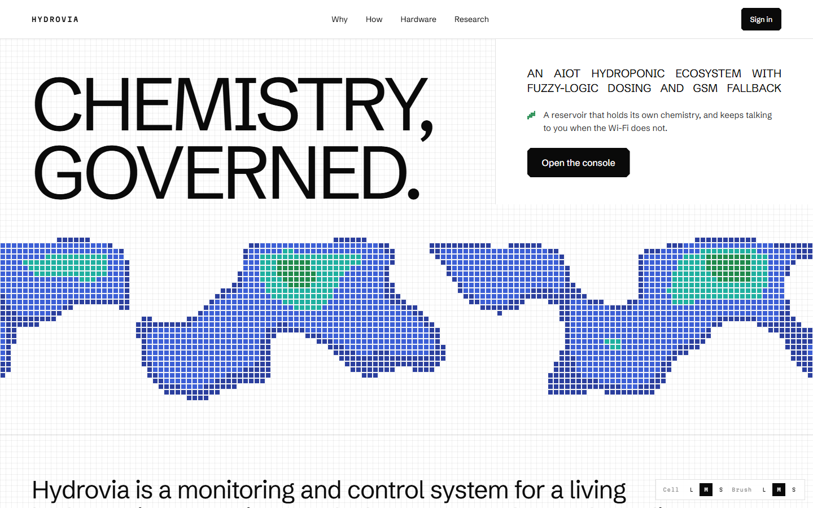
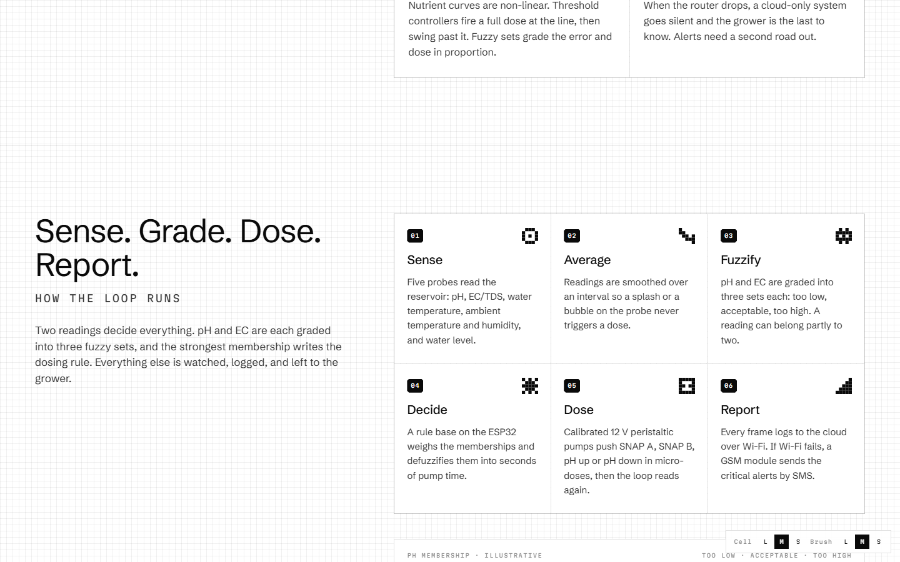
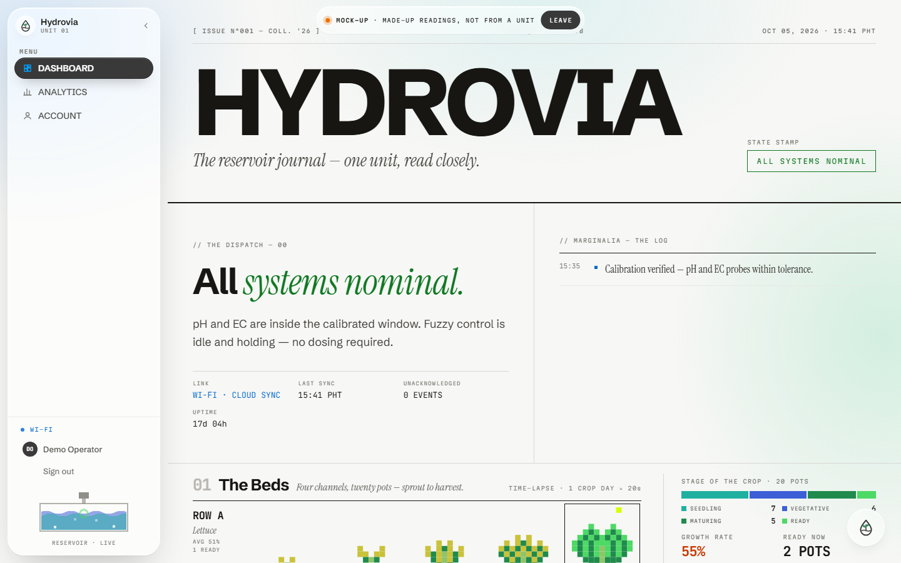
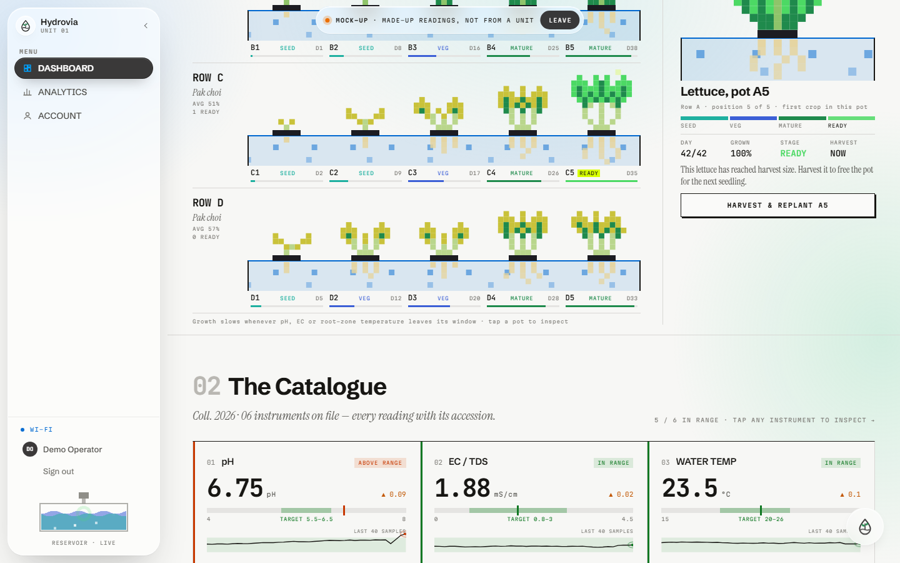
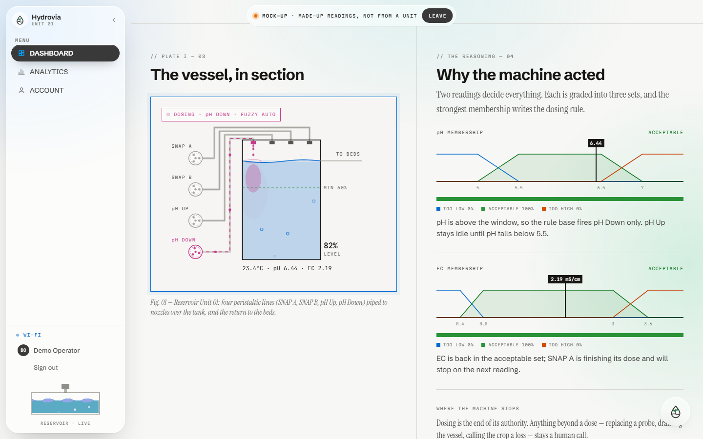

# HYDROVIA

**Chemistry, governed.**

An AIoT hydroponic ecosystem with fuzzy-logic dosing and GSM fallback alerts: the firmware's brain, plus the web console to watch and command it.

[**Live Demo →**](https://hydrovia-ph.vercel.app) *(use "View mock-up" on the sign-in screen to explore with sample data)*

    

---

> **This repo is a showcase.** It covers what Hydrovia is and how I built the web console. The source code is kept in a private repository.

## The project

Hydrovia is a Computer Engineering thesis prototype, built with two groupmates at LPU–Cavite: *"A Development of an AIoT Hydroponic Ecosystem Featuring Fuzzy Logic Automated Dosing and GSM Fallback Notifications."*

A hydroponic reservoir only works while its pH and nutrient strength (EC) stay inside a narrow window. Most growers check by hand, and simple controllers dose a full measure at the threshold and then overshoot. Hydrovia measures continuously, doses in proportion, and keeps talking when the Wi-Fi doesn't.

### The system

| Layer | What it does |
|---|---|
| **Sensing** | Five probes: pH, EC/TDS, water temperature, air temperature and humidity, and water level. |
| **Controller** | An ESP32 samples and averages readings, runs the fuzzy-logic controller, and handles Wi-Fi and GSM. |
| **Fuzzy dosing** | pH and EC are each graded into *too low / acceptable / too high*. A rule base turns the strongest memberships into seconds of pump time. In range means no dose. |
| **Actuators** | Four 12 V peristaltic pumps: nutrient SNAP A, SNAP B, pH Up and pH Down. Only the pump the situation calls for runs. |
| **Comms** | Readings log to the cloud over Wi-Fi. If Wi-Fi fails or something abnormal happens, a SIM800L GSM module sends SMS alerts. |
| **Console** | This web app: live readings, charts, history, fuzzy-reasoning explanations and manual pump override. |

**Targets:** pH 5.5–6.5 and EC 0.8–3.0 mS/cm, for lettuce and pak choi on UPLB SNAP nutrients. **Aligned with** UN SDGs 2, 9 and 12.

**Scope:** Hydrovia deliberately does not do pest or disease detection, climate control, dissolved-oxygen or CO₂ sensing, yield forecasting or commercial scale. The thesis's results chapter isn't written yet, so this showcase makes **no performance claims**. The numbers in the demo are simulated.

## Screens

## What's in the web app

- **Landing page.** A pixel-art "heat field" you can draw on with the pointer: the trail thins when you move fast, a held click crackles with sparks and a release fires a fractal lightning tree. Buttons ignite a flickering flame border as the pointer nears them, and the cursor turns into a sprout, a water drop or a lightning bolt. All of it is original, hand-written canvas code.
- **Operator console.** Live pH / EC / temperature / humidity / level readings with target-window gauges and sparklines, an alert log and a "dispatch" summary of the system's state.
- **The Beds.** A pixel crop time-lapse: four channels, twenty net pots of lettuce and pak choi growing from sprout to harvest. Growth slows and leaves yellow when pH, EC or root-zone temperature leave their windows.
- **The Vessel.** A cut-away of the tank with each pump piped to its own nozzle. A dose shows up as flowing pipes, falling drops, ripples and a mixing plume, with a countdown.
- **Why the machine acted.** Live fuzzy-membership charts with the current reading marked, and a plain-language reason for every dose.
- **The Hands.** One card per pump with a spinning rotor, the reading it answers to and a **Dose by hand** override, protected by a confirm step and a cooldown.
- **Analytics.** 24-hour to 30-day ranges, summary stats, six charts with crosshair readouts, a dosing ledger and link history, with CSV export.
- **Admin console.** Overview KPIs, user management with roles, device status, live-editable settings (target windows, dose length and gap, alert rules, SMS recipients, refresh rate, maintenance mode) and an audit trail.
- **Hydrovia AI.** A floating assistant that gives a daily summary and answers questions, grounded on a live snapshot of what the console shows. It says so plainly when it doesn't have a number instead of inventing one.
- **Real accounts.** Request access, accept by email, verification, profile editing and account deletion, with roles enforced by the database and not by the front end.
- **Desktop and mobile.** Checked at 1440 px and 390 px. Motion respects `prefers-reduced-motion`.

## How I built it

1. **Started from a design.** The first version came from a Claude Design project (the "Hydrovia v2" console), which I ported into Vite + React one-to-one. No UI library and no chart library: every chart, gauge and sprite is hand-drawn SVG, CSS or canvas.
2. **Added an original hero page.** I studied what makes an interactive pixel landing page feel good (paper-and-ink palette, a faint cell grid, notched buttons, a heat field) and built my own version: own engine, own sprites, own pixel typeface and own copy, with the thesis as the content.
3. **Iterated on feedback, round by round.** Early rounds were mostly feel: no dot under the cursor, faster click response, a flame frame instead of a plain outline, fractal lightning instead of a circle, the swipe trail on touch screens.
4. **Made motion carry meaning.** After sign-in there is no decorative field, so controls and numbers show up first. Every console animation is driven by data: readings tween between samples, charts draw in on range change, the tank level eases, pumps cross-fade colour.
5. **Made the simulation honest and swappable.** A deterministic loop produces readings every 2.5 seconds and cycles through excursions: EC drifts high and triggers an automatic dose, then Wi-Fi drops to GSM fallback. A real telemetry feed can replace it without changing the view-model or any animation.
6. **Followed the research and not the demo.** When a design detail contradicted the thesis, the thesis won. For example, the pH adjuster became two pumps (Up and Down) with one probe, and the fuzzy rules choose which one fires.
7. **Added the admin side.** Settings are live: changing a target window rewrites the statuses, gauges, fuzzy sets and crop growth on the spot.
8. **Added Hydrovia AI.** It is modelled on the concierge I built for [SOLE](https://github.com/ThirdyTapawan/sole-demo). A serverless function calls Gemini with the key kept server-side, and each request carries a compact snapshot of the current readings, pumps and alerts so answers stay grounded.
9. **Moved to real accounts on Supabase.** Authentication, a roles table with row-level security, and edge functions for access requests and email. A user can never grant themselves a role.
10. **Liquid-glass pass.** A single shared glass recipe now drives both side rails and both consoles, each with its own small animation: a growth channel for admins and a live reservoir for operators.
11. **Verified every change.** Each round was linted to zero warnings and built. I then drove the real UI in a headless browser (sign in, hover, click, drag, scroll, check for horizontal overflow) and looked at screenshots before shipping.

## Roadmap

- Replace the simulation with live telemetry from the prototype over a cloud broker.
- Firmware-side safety limits (maximum dose length and minimum gap) so a bad command can never overdose the tank, whatever the site sends.
- Fill in measured results once the thesis testing is complete.

## Tech stack

React 19 · Vite · plain CSS · hand-built SVG and canvas · Supabase (Auth, Postgres with RLS, Edge Functions) · Vercel serverless functions · Google Gemini API · ESP32 (firmware, separate)

## About

Built by **Angelito "Thirdy" Tapawan III**, Computer Engineering student at LPU–Cavite.

[Portfolio](https://thirdytapawan.vercel.app/) · [LinkedIn](https://www.linkedin.com/in/angelito-tapawan-iii/) · [GitHub](https://github.com/ThirdyTapawan)
